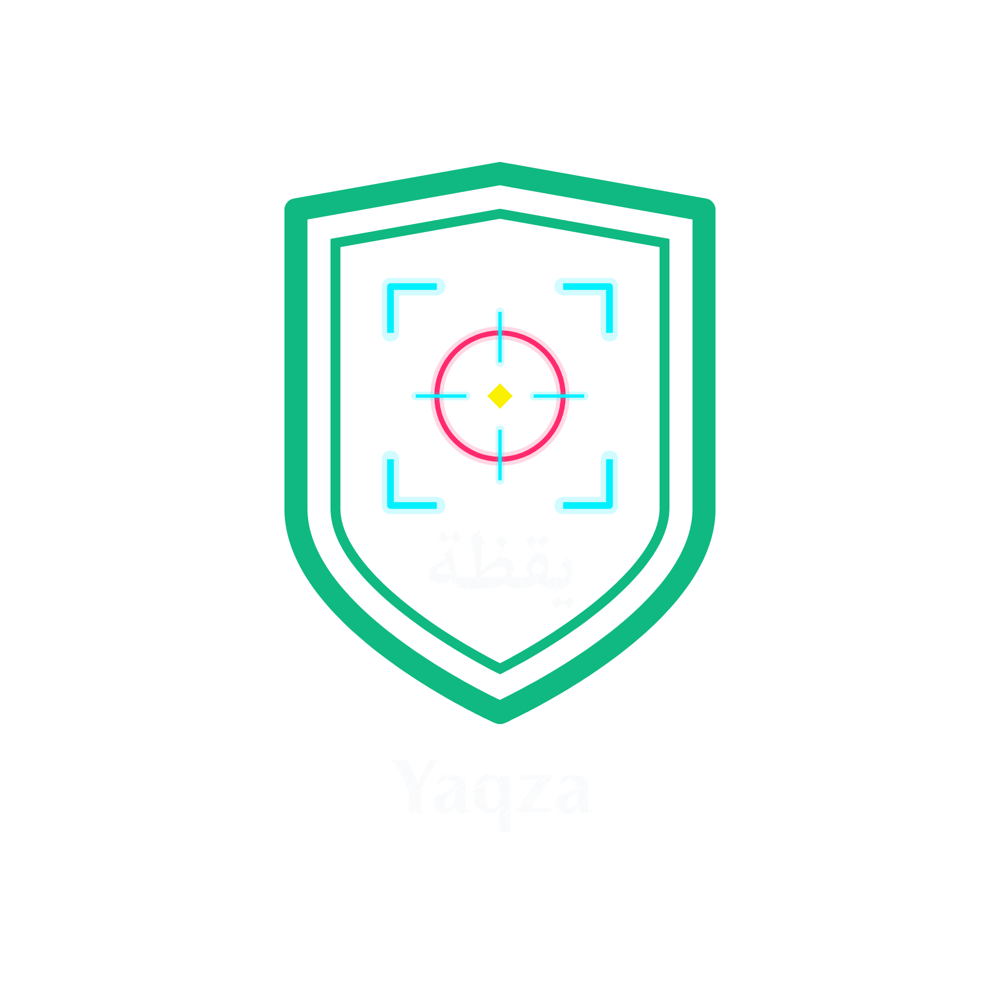

  

# يقظة | Yaqza

لعبة تعليمية بالعربية تعلّم مبادئ الأمن السيبراني والامتثال: أنت مسؤول الأمن في شركة وهمية، وفي كل غرفة موقف عملي، وفي النهاية تحصل على تقرير بدرجتك لكل مجال (الحوكمة، الدفاع، الصمود).

> اسم المشروع مكتوب في ملف واحد: `config.py`.

An Arabic educational game that teaches cybersecurity and compliance basics through short workplace scenarios, then produces a scored report per domain (Governance, Defense, Resilience).

**Not an official compliance tool.** Inspired by the principles of the Saudi NCA Essential Cybersecurity Controls (ECC); it does not reproduce their text. All data and scenarios are fictional.

## الغرف الحالية

| الغرفة | المهارة |
|---|---|
| 1. كلمات المرور | عبارات المرور، MFA، أقل صلاحية، سياسة مكتوبة |
| 2. السجلات | قراءة سجل دخول، كشف هجوم تخمين، أول إجراء للاستجابة |
| 3. فحص الشبكة (Nmap) | قراءة مخرجات Nmap، والخدمات غير المشفرة، وإذن الفحص |
| 4. التصيّد الاحتيالي | كشف رسائل التصيّد، وانتحال المدير، والإبلاغ، والتعامل بعد النقر |
| 5. الاستجابة لحوادث الفدية | العزل، والنسخ الاحتياطي، وقرار الدفع، والإزالة، والدروس المستفادة |

## التشغيل
    python -m venv .venv
    .venv\Scripts\activate          # على Linux/macOS: source .venv/bin/activate
    pip install -r requirements.txt
    streamlit run app.py

## الاختبارات
    pip install -r requirements-dev.txt
    pytest -q

## إضافة غرفة جديدة
أنشئي ملفًا في `levels/` باسم `roomN_name.json` يتبع نفس بنية الغرف الموجودة (id، title، story، evidence، questions). التحقق من البنية يتم تلقائيًا في الاختبارات.

## الهيكل
    app.py              واجهة Streamlit
    config.py           الاسم والمجالات ومستويات الدرجة
    engine/             تحميل الغرف، وحساب الدرجات والتقرير
    levels/             الغرف (ملف JSON لكل غرفة)
    tests/              اختبارات pytest

المؤلفة: حصه بنت فهد المسيب (Hussa Almusayab) · الرخصة: MIT
